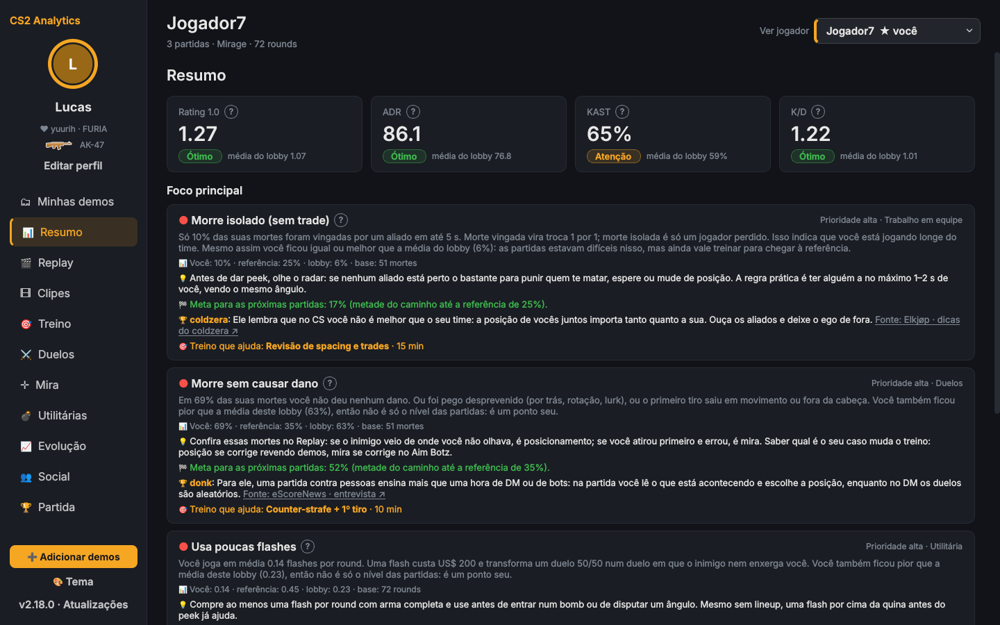
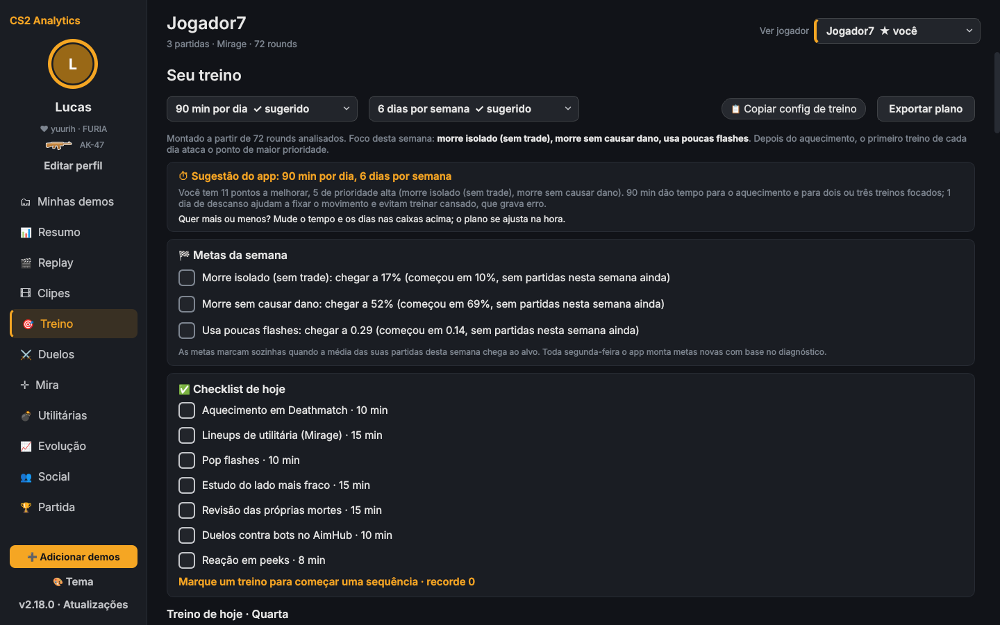
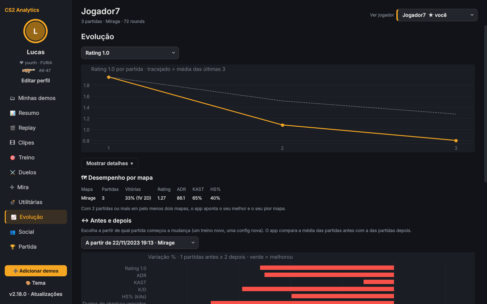
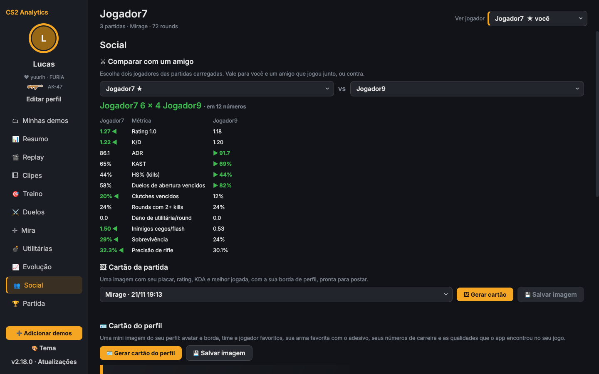
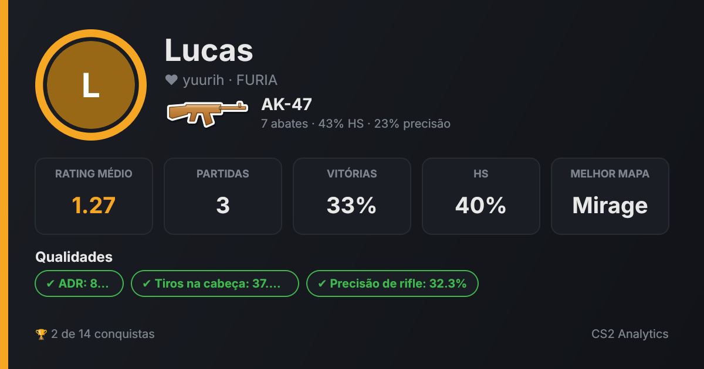

# CS2 Analytics

[](https://github.com/Lucas-oss444/CS2_analytics/actions/workflows/testes.yml)


App desktop que lê as demos de Counter-Strike 2, calcula as estatísticas de cada jogador, aponta os pontos fracos e monta um plano de treino semanal, com dicas de jogadores profissionais, replay 2D, clipes das melhores jogadas e acompanhamento da evolução.

Funciona 100% offline: não pede login, não acessa a internet e não interage com o processo do jogo. Ele só lê arquivos `.dem` já salvos no PC.



## Funcionalidades

- **Diagnóstico:** rating, ADR, KAST, K/D, aberturas, trades, clutches, mira e utilitárias, comparados com o lobby e com uma referência. Cada problema vem com explicação, meta e treino recomendado.
- **Plano de treino:** o app sugere minutos por dia e dias por semana com base nas estatísticas, e o jogador pode ajustar. Tem também metas semanais que marcam sozinhas, checklist diário com sequência de dias e um botão para copiar a config de treino.
- **Dicas de pros:** dicas de 17 jogadores profissionais com a fonte de cada uma. O jogador favorito, escolhido no perfil, ganha prioridade.
- **Replay 2D:** a partida vista de cima, com bombs A e B marcados. O mapa é desenhado a partir das posições dos jogadores, sem usar arquivos do jogo.
- **Clipes:** detecção automática de ACE, 4K, 3K e clutches, clipes manuais e abertura do lance no CS2 em primeira pessoa (com modo de gravação sem HUD).
- **Evolução:** gráfico de qualquer métrica, desempenho por mapa e comparação antes e depois de uma mudança.
- **Social:** comparação com um amigo, conquistas e cartões em PNG da partida e do perfil.
- **Perfil:** avatar, 25 bordas desbloqueáveis, efeitos animados, time, jogador e arma favoritos (com adesivo desenhado pelo app) e vários temas.

| Treino | Evolução |
|---|---|
|  |  |

| Social | Cartão do perfil |
|---|---|
|  |  |

## Tecnologias

- **Python** com **PySide6** (Qt) na interface e **matplotlib** nos gráficos
- **demoparser2** para ler as demos e **pandas**/**numpy** para as estatísticas
- **SQLite** para o histórico e **Parquet** (pyarrow) para a biblioteca de demos
- **pytest** e **GitHub Actions** para rodar os testes automaticamente no Windows a cada push

## Estrutura

```
cs2coach/
  demo.py       leitura e limpeza das demos (.dem, .zst, .gz, .bz2)
  stats.py      métricas por jogador, por round e por arma
  coach.py      regras do diagnóstico, treinos, plano semanal e dicas de pros
  progress.py   evolução por mapa, antes e depois, metas, conquistas e carreira
  replay.py     reconstrução do round, melhores jogadas e mapa 2D
  storage.py    histórico SQLite e configuração
  library.py    biblioteca de demos e lixeira
  updater.py    instalador de atualizações com verificação e backup
  card.py       geração dos cartões em PNG
  weapons.py    adesivos das armas desenhados com QPainter
  ui.py, replay_ui.py, clips_ui.py, dialogs.py, profile.py, theme.py   interface
tests/          147 testes automatizados
```

## Como rodar

Requer Python 3.10+ (Windows, Linux ou macOS).

```
pip install -r requirements.txt
python main.py
```

No Windows, `build_exe.bat` gera um executável e `criar_atalho.bat` coloca o app no Menu Iniciar.

As demos de Premier e Competitivo ficam em `Steam\steamapps\common\Counter-Strike Global Offensive\game\csgo\replays`. As da FACEIT podem ser abertas compactadas.

O guia completo de uso está em [docs/MANUAL.md](docs/MANUAL.md).

## Testes

```
pip install pytest
python -m pytest -q tests
```

Os testes rodam numa pasta temporária, com a rede bloqueada. Eles cobrem:
- o cálculo das estatísticas e o diagnóstico;
- dados extremos e corrompidos;
- demos maliciosas;
- o instalador de atualizações;
- todas as abas da interface, para vários jogadores e em todos os temas.

## Segurança

- Não há login, conta Steam nem acesso à rede. O app não lê a memória do jogo nem desenha sobre ele.
- Arquivos de demo são validados pelo cabeçalho e limitados a 2 GB, inclusive depois de descompactar.
- Nomes vindos das demos são escapados antes de aparecer na tela, e as consultas SQL são parametrizadas.
- Os dados do jogador ficam só no PC, em `~/.cs2coach/`.

## Aviso

Projeto pessoal e sem fins comerciais, sem ligação com a Valve Corporation. Counter-Strike e CS2 são marcas da Valve. As dicas de jogadores profissionais são resumos com link para a fonte original.

## Licença

[MIT](LICENSE) © Lucas Sousa Jatene
